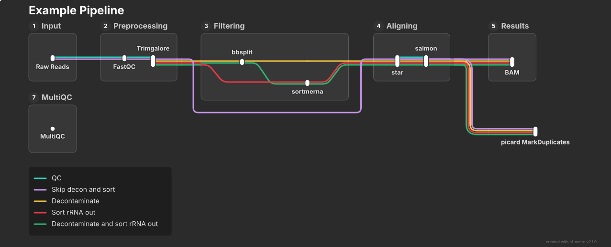
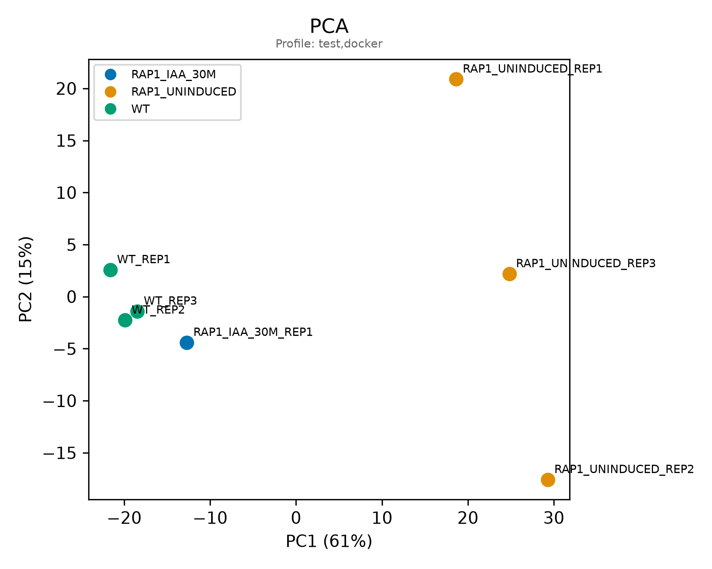
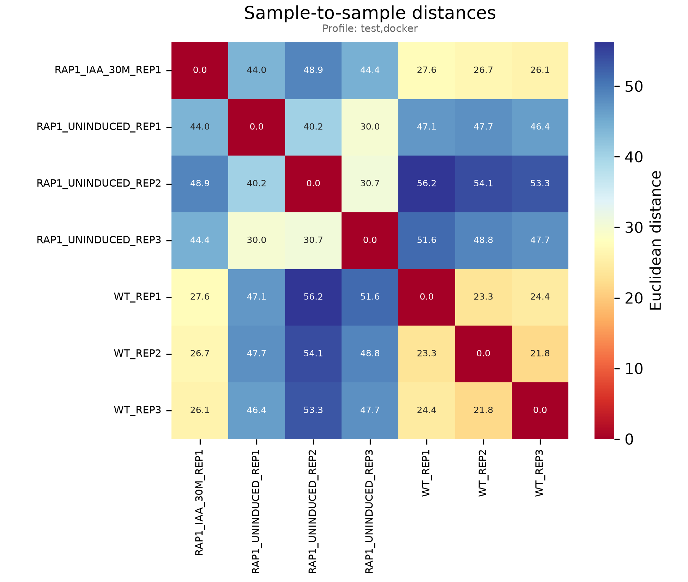

<h1>
  <picture>
    <source media="(prefers-color-scheme: dark)" srcset="docs/images/nf-core-rnaseqgangganggang_logo_dark.png">
    
  </picture>
</h1>

[](https://github.com/codespaces/new/nf-core/rnaseqgangganggang)
[](https://github.com/nf-core/rnaseqgangganggang/actions/workflows/nf-test.yml)
[](https://github.com/nf-core/rnaseqgangganggang/actions/workflows/linting.yml)[](https://nf-co.re/rnaseqgangganggang/results)[](https://doi.org/10.5281/zenodo.XXXXXXX)
[](https://www.nf-test.com)

[](https://www.nextflow.io/)
[](https://github.com/nf-core/tools/releases/tag/4.1.0)
[](https://docs.conda.io/en/latest/)
[](https://www.docker.com/)
[](https://sylabs.io/docs/)
[](https://cloud.seqera.io/launch?pipeline=https://github.com/nf-core/rnaseqgangganggang)

[](https://nfcore.slack.com/channels/rnaseqgangganggang)[](https://bsky.app/profile/nf-co.re)[](https://mstdn.science/@nf_core)[](https://www.youtube.com/c/nf-core)

<!-- INHALTSVERZEICHNIS -->
## Contents

- [Introduction](#introduction)
- [Usage](#usage)
  - [Input samplesheet](#samplesheet)
  - [Skipping preprocessing steps](#skipping-preprocessing-steps)
  - [Running the pipeline](#running-the-pipeline)
  - [Test pipeline](#test-pipeline)
- [Pipeline output](#pipeline-output)
- [Credits](#credits)
- [Contributions and Support](#contributions-and-support)


## Introduction

**nf-core/rnaseqgangganggang** is a bioinformatics pipeline that analysis paired-end RNA-seq data. The pipeline performs read quality control, adapter trimming, removal of genomic contaminants and rRNA, STAR alignment, duplicate marking, transcript quantification with Salmon, and gene-level TPM summarization. Quality-control metrics are summarized in a MultiQC report.




1. Read QC ([`FastQC`](https://www.bioinformatics.babraham.ac.uk/projects/fastqc/))
2. Adapter and Quality trimming ([`TrimGalore!`](https://www.bioinformatics.babraham.ac.uk/projects/trim_galore/))
3. Removal of contaminations ([`BBSplit`](https://bbmap.org/tools/bbsplit))
4. Removal of rRNA ([`SortMeRNA`](https://github.com/sortmerna/sortmerna))
5. Read Alignment ([`STAR`](https://github.com/alexdobin/STAR))
6. Quantification ([`Salmon`](https://salmon.readthedocs.io/en/latest/))
7. Reference FASTA Indexing ([`SAMtools`](https://www.htslib.org/))
8. Marking of Duplicates ([`picard MarkDuplictes`](https://broadinstitute.github.io/picard/command-line-overview.html))
9. Gene-level TPM summarization ([`tximport`](https://bioconductor.org/packages/release/bioc/html/tximport.html))
10. Summary QC report ([`MultiQC`](https://docs.seqera.io/multiqc/))

<!-- (http://multiqc.info/) -->
## Usage

> [!NOTE]
> If you are new to Nextflow and nf-core, please refer to [this page](https://nf-co.re/docs/get_started/environment_setup/overview) on how to set-up Nextflow. Make sure to [test your setup](https://nf-co.re/docs/get_started/run-your-first-pipeline) with `-profile test` before running the workflow on actual data.


### Samplesheet
First, prepare a samplesheet with your input data that looks as follows:

`samplesheet.csv`:
```csv
sample,fastq_1,fastq_2
CONTROL_REP1,AEG588A1_S1_L002_R1_001.fastq.gz,AEG588A1_S1_L002_R2_001.fastq.gz
```

Each row represents a pair of fastq files (paired end).

### Skip preprocessing steps

If you want you can skip Removal of genomic contaminations ([`BBSplit`](https://bbmap.org/tools/bbsplit)) and/or Removal of ribosomalRNA ([`SortMeRNA`](https://github.com/sortmerna/sortmerna)). Herefore you need an `-params-file` that looks as follows:

`benchmark.yml`:
```yaml
skip_bbsplit: true
skip_sortmerna: true
```

### Running the pipeline

Now, you can run the pipeline from your working directory using:


```bash
nextflow run . \
   -profile <docker/singularity/.../institute> \
   --input samplesheet.csv \
   --outdir <OUTDIR> \
   --fasta file.fa \
   --gtf file.gtf \
   --transcript_fasta transcripts.fa \
   --rrna_fasta rrna.fa \
   --bbsplit_primary_ref file.fa\
   --bbsplit_other_ref contaminant.fa
```

> [!WARNING]
> Please provide pipeline parameters via the CLI or Nextflow `-params-file` option. Custom config files including those provided by the `-c` Nextflow option can be used to provide any configuration _**except for parameters**_; see [docs](https://nf-co.re/docs/running/run-pipelines#using-parameter-files).

<!-- For more details and further functionality, please refer to the [usage documentation](https://nf-co.re/rnaseqgangganggang/usage) and the [parameter documentation](https://nf-co.re/rnaseqgangganggang/parameters). -->


### Test pipeline

You can test the pipeline with a existing dataset using the following command from your working directory:

```bash
nextflow run . \
  -profile test,<docker/singularity> \
  --outdir <OUTDIR>
```

## Pipeline output

All pipeline results are written to the directory specified with --outdir.

The output includes quality-control reports, alignment files, duplicate-marked BAM files, Salmon quantification results, and the final gene-level TPM table with a PCA plot and a sample-to-sample distance plot from that TPM table. Example Plots are shown below from out test profile run.

<p align="center">
  
  
</p>

<!-- To see the results of an example test run with a full size dataset refer to the [results](https://nf-co.re/rnaseqgangganggang/results) tab on the nf-core website pipeline page.
 For more details about the output files and reports, please refer to the
[output documentation](https://nf-co.re/rnaseqgangganggang/output). -->

## Credits

nf-core/rnaseqgangganggang was originally written by peter and anna.

We thank the following people for their extensive assistance in the development of this pipeline:

Laura (loperalaura), Saniya (saniyakhann), Mark (mapo9), Julian (JulianFlesch)

## Contributions and Support

If you would like to contribute to this pipeline, please see the [contributing guidelines](docs/CONTRIBUTING.md).

For further information or help, don't hesitate to get in touch on the [Slack `#rnaseqgangganggang` channel](https://nfcore.slack.com/channels/rnaseqgangganggang) (you can join with [this invite](https://nf-co.re/join/slack)).

## Citations


An extensive list of references for the tools used by the pipeline can be found in the [`CITATIONS.md`](CITATIONS.md) file.

You can cite the `nf-core` publication as follows:

> **The nf-core framework for community-curated bioinformatics pipelines.**
>
> Philip Ewels, Alexander Peltzer, Sven Fillinger, Harshil Patel, Johannes Alneberg, Andreas Wilm, Maxime Ulysse Garcia, Paolo Di Tommaso & Sven Nahnsen.
>
> _Nat Biotechnol._ 2020 Feb 13. doi: [10.1038/s41587-020-0439-x](https://dx.doi.org/10.1038/s41587-020-0439-x).
